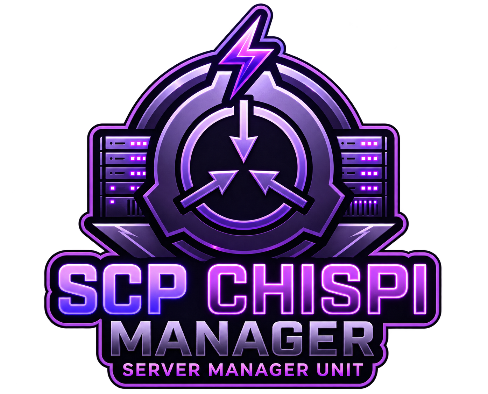
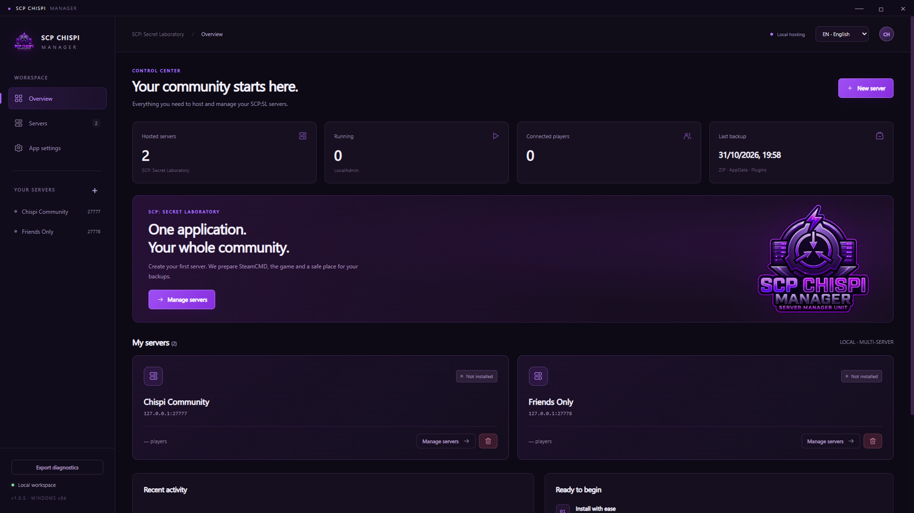
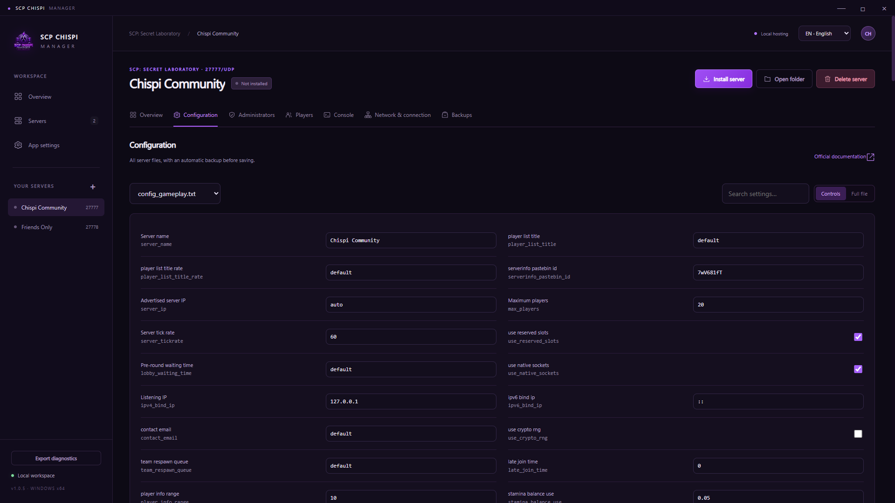
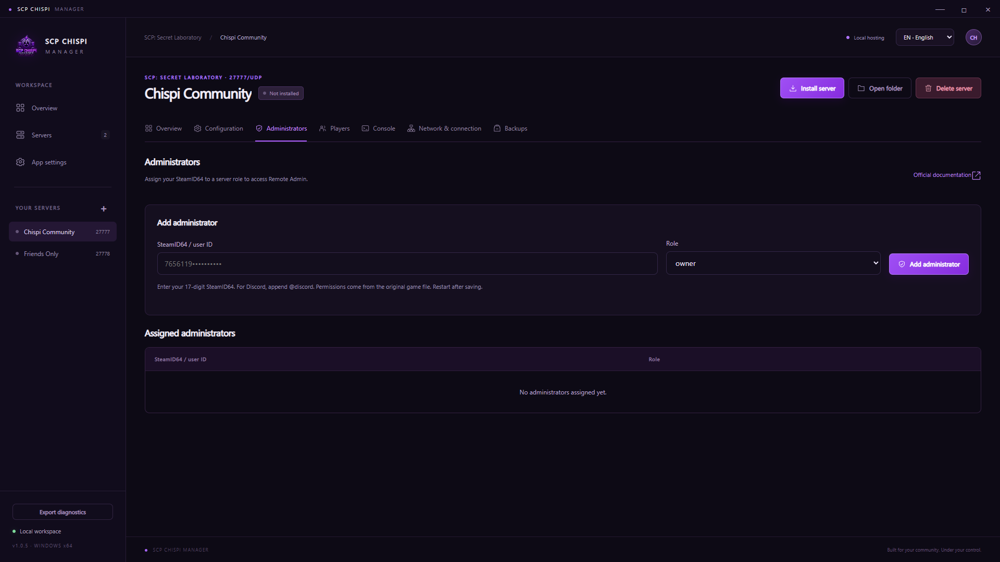
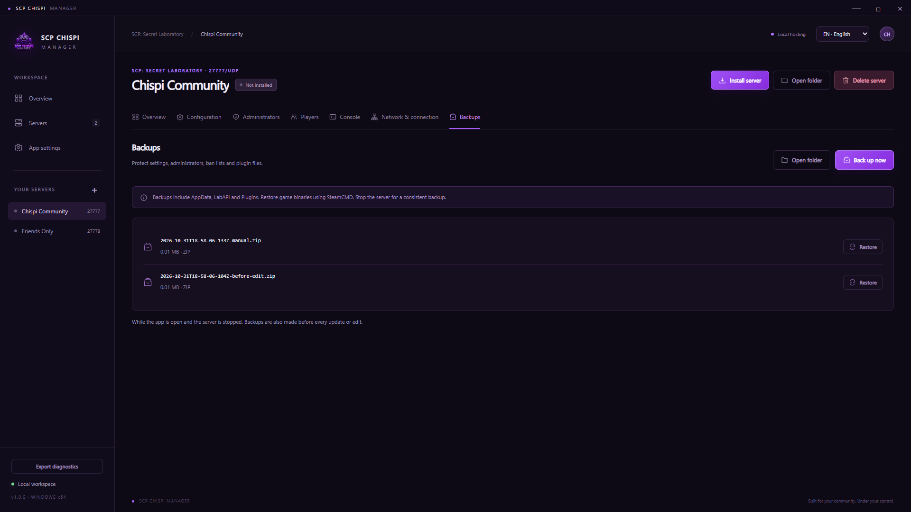
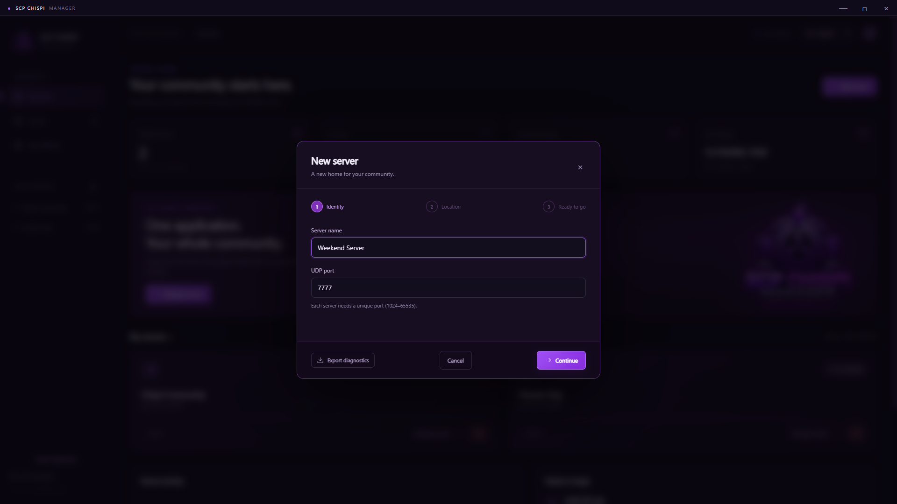

# SCP Chispi Manager

<p align="center"></p>

A dark, purple Windows desktop application for hosting and managing multiple **SCP: Secret Laboratory** dedicated servers in one place.

> **AI DISCLOSURE:** This project was developed with extensive AI assistance using **OpenAI ChatGPT/Codex**. AI was used to generate and revise application code, interface design, tests, troubleshooting changes, translations, and documentation under the project owner's direction. The transparent logo was prepared with **OpenAI ImageGen** from a user-supplied reference. See [AI disclosure](docs/AI-DISCLOSURE.md).

**Version: 1.0.5.** Intended platform: Windows 10 and Windows 11, x64 Intel/AMD. The interface supports English, Spanish, Russian, Simplified Chinese, Japanese, and Portuguese.

This independent community project is not an official Northwood, Valve, Microsoft, Radmin, or OpenAI product.

## Download for Windows

**[Download the Windows installer — v1.0.5](https://github.com/Chispinela/scp-chispi-manager/releases/download/v1.0.5/SCP-Chispi-Manager-Setup-1.0.5.exe)**

For **Windows 10 / Windows 11 x64 (Intel/AMD)**. Download the EXE and run it to choose your installation folder. No Node.js installation or source build is required. The game is downloaded separately by the server wizard.

[Release notes and SHA-256 checksum](https://github.com/Chispinela/scp-chispi-manager/releases/tag/v1.0.5) · [All releases](https://github.com/Chispinela/scp-chispi-manager/releases)

## Screenshots

Real English application captures with isolated example profiles. No real players, private addresses, credentials, or personal logs are shown. Click an image for its full-resolution view. [Capture details](docs/SCREENSHOTS.md).

[](docs/screenshots/dashboard.png)

| Configuration | Administration |
| --- | --- |
| [](docs/screenshots/configuration.png) | [](docs/screenshots/administration.png) |

| Backups | New server wizard |
| --- | --- |
| [](docs/screenshots/backups.png) | [](docs/screenshots/server-wizard.png) |

## Features

| Area | What it provides |
| --- | --- |
| Multiple servers | Separate profiles, folders, processes, ports, and configuration files. |
| Installation | Folder selection, official SteamCMD download, and dedicated-server installation/update using Steam App **996560** with anonymous login. |
| Live progress | Current installation task, real SteamCMD output, and completed/remaining percentages for each reported phase. |
| Controls | Start, graceful stop, restart, confirmed forced stop, real console output, commands, filtering, and log export. |
| Configuration | A form for scalar options and a raw editor for the installed game's complete configuration templates, lists, and advanced settings. |
| Administration | Assign/remove Remote Admin members with existing game roles and SteamID64 or Discord identifiers. |
| Players | Query the real `players` command, display profile identifiers, open Steam profiles, and check VAC/game-ban history with your own Steam API key. |
| Networking | Select Windows IPv4 adapters, including installed VPN adapters, and copy the connection IP and port. |
| Backups | ZIP backups, backups before edits/updates/restores, configurable retention, and scheduled backups while the app is open. |
| Removal | Remove a profile while retaining files, or send its dedicated directory to the Windows Recycle Bin. |
| Diagnostics | Persistent rotating logs, system/CPU/GPU details, exact filesystem operations, and ZIP export inside the creation wizard. |

Percentages come from SteamCMD. Download and verification have separate percentages; the app does not invent an overall figure when SteamCMD has not reported one.

## Install and create a server

1. [Download the Windows installer](https://github.com/Chispinela/scp-chispi-manager/releases/download/v1.0.5/SCP-Chispi-Manager-Setup-1.0.5.exe), run it, and choose the application directory and shortcuts.
2. Choose **English** in the top-right language menu if needed.
3. Select **New server** and choose a name, unique UDP port, and hosting directory. Server storage is independent of the application installation directory.
4. Read the SCP:SL EULA and accept it only if you agree. Keep the installation option enabled to download SteamCMD and the dedicated server.
5. Follow live output in **Console** and install the Windows components required by the game if needed.
6. Start the server. The manager marks it as running after the real console reports a startup message such as **Waiting for players**.
7. Stop the server before editing settings, assigning administrators, updating, restoring backups, or deleting files.

This source repository does not include installed servers, SteamCMD, or SCP:SL game binaries. The manager obtains the dedicated server from Valve. See [Windows compatibility](docs/COMPATIBILIDAD-WINDOWS.md) for requirements and test limits.

## If creation stalls after accepting the EULA

Version 1.0.5 prepares folders and initial files in a separate helper process. If preparation exceeds 30 seconds, the manager stops waiting, reports an error, and restores the wizard controls. It saves the profile only after successful helper completion and exit.

Select **Use alternative local folder** in the location step or after an error, review the proposed path, and retry. You can also choose another location. Switching preserves the wizard's name, port, and EULA selection. Partial folders from failures are retained rather than deleted automatically.

A reported Windows 11 stall was traced to folder preparation under Documents, before SteamCMD started. Its underlying Windows cause and the fix on that particular computer remain unconfirmed.

## Export diagnostics

Reproduce the problem and select **Export diagnostics** in the sidebar, creation wizard, or application settings. Save and review the ZIP before attaching it to an issue. Logs survive restarts.

Reports may contain Windows user names in paths, IP addresses, player identifiers from console output, CPU/GPU details, and errors. They exclude `manager.json`, configuration files, backups, and the stored Steam API key; known credentials are redacted. Nothing is sent automatically. See [Diagnostics](docs/DIAGNOSTICO.md) for contents, locations, and limits.

## Radmin VPN and networking

1. Install Radmin VPN from its official site. Create or join a network in **Radmin VPN** on every participating computer. Manage network names, passwords, and membership in Radmin itself.
2. With the game server stopped, open the manager's network tab, refresh adapters, select Radmin, and apply the selection.
3. Allow the game process and chosen UDP port through Windows Firewall for that interface.
4. Start the server and use SCP:SL **Direct Connect** with the Radmin IP and port. Participants need compatible game versions and the same VPN network.

The manager selects an existing Windows adapter; it does not create VPN networks or store VPN passwords. A VPN can provide a route without router port forwarding, subject to game/network configuration. A real connection from another computer through Radmin has not been verified in this project.

Keep online authentication enabled. If the server reports a connection/authentication IP mismatch, consult `enforce_same_ip` and the game's official documentation before changing it. For public hosting, distinguish LAN and public IPs and configure the necessary router/firewall rules. Public listing also has Northwood verification requirements.

## Player and VAC information

Save your own [Steam Web API key](https://steamcommunity.com/dev/apikey) in settings to query Valve's `GetPlayerBans` endpoint. Steam identifiers are sent to Valve for this lookup. A VAC ban is Steam profile information, not a local ban on your server. Discord identifiers need a corresponding SteamID for VAC lookup.

The key is encrypted through Electron `safeStorage` with Windows account protection and can be removed in settings. Stored keys are not returned to the renderer. A failed player query is not treated as an authoritative empty list, and VAC results are not fabricated. Real connected-player and authenticated VAC tests remain pending.

## Storage and backups

```text
<selected hosting directory>/
  steamcmd/
  servers/<name>-<id>/
    game/
      LocalAdmin.exe
      SCPSL.exe
      hoster_policy.txt
      AppData/config/<port>/
    backups/*.zip
```

`hoster_policy.txt` sets `gamedir_for_configs: true`, keeping each server's configuration inside its own game directory. The tested LocalAdmin version also requires `--skipHomeCheck` with this policy. Manager metadata lives in its application user-data directory; corrupt metadata is not silently overwritten.

Backups include AppData, LabAPI, and Plugins, rather than entire game installations. Redownload game binaries through update/verification. Scheduled backups require the app to stay open and the server to be stopped. Keep independent copies on another disk if required.

Removal requires an idle server. Recycling is restricted to the selected managed directory and never silently falls back to permanent deletion. Shared SteamCMD and other profiles are retained. Uninstalling the manager does not remove hosted servers.

## Build from source

Use **Windows x64 and Node.js 24 or later**. Packaged-app users do not need Node.js, Electron, Visual Studio, or Windows Terminal installed separately.

```powershell
npm ci
node node_modules/electron/install.js
npm start
```

Build the unpacked application or NSIS installer:

```powershell
npm run pack
npm run dist
```

Generated outputs:

```text
release/win-unpacked/SCP Chispi Manager.exe
release/SCP-Chispi-Manager-Setup-1.0.5.exe
```

The installer offers directory selection, shortcuts, and six languages. Current builds are not code signed. Build outputs are excluded from source control; publish downloadable installers as release assets rather than committing them to source history.

`Iniciar SCP Chispi Manager.cmd` opens the compiled app with project-local data in `runtime/manager`. No runtime profiles are included in the upload. `tools-bootstrap.cjs` is a development helper that installs a real dedicated server; read the script and EULA before using it.

## Tests and verification

```powershell
npm test
npm run test:ui
npm run test:diagnostics
npm run test:folder-recovery
```

`npm test` covers configuration preservation, roles, path restrictions, ports, persistence, backup restoration, safe removal, terminal selection, credential redaction, log rotation/export, and termination of a blocked folder helper. UI tests open real Electron windows and use isolated directories under `output/`.

After packaging:

```powershell
node tests/folder-recovery-ui.cjs --packaged
```

Additional scripts may use existing `runtime/` profiles, start real game processes, download server files, or test the real Recycle Bin. Read [Verification and test limits](docs/VERIFICACION.md) before running them.

Windows build-selection tests do not certify every OS release. Historical live tests verified two local server instances, actual zero-player responses, configuration templates, console commands, and graceful shutdown. Remote multiplayer, authenticated VAC queries, and every Windows 10/11 build were not verified.

## AI transparency, license, and third-party components

**AI assistance is a central part of this project's development history.** [AI disclosure](docs/AI-DISCLOSURE.md) explains the role of ChatGPT/Codex and ImageGen and distinguishes generated work from verified behavior.

Project source is licensed under the [MIT License](LICENSE). Dependencies retain their own licenses. The source license does not grant rights to third-party branding, trademarks, or downloaded game software. See [logo provenance](docs/logo.md).

Official references:

- [Dedicated server setup](https://techwiki.scpslgame.com/books/server-guides/page/1-how-to-create-a-dedicated-server)
- [Gameplay configuration](https://techwiki.scpslgame.com/books/server-guides/page/2-gameplay-config-setup)
- [Remote Admin configuration](https://techwiki.scpslgame.com/books/server-guides/page/3-remote-admin-config-setup)
- [LocalAdmin source and arguments](https://github.com/northwood-studios/LocalAdmin-V2)
- [Steam GetPlayerBans](https://partner.steamgames.com/doc/webapi/ISteamUser)
- [Radmin VPN help](https://www.radmin-vpn.com/help/)
