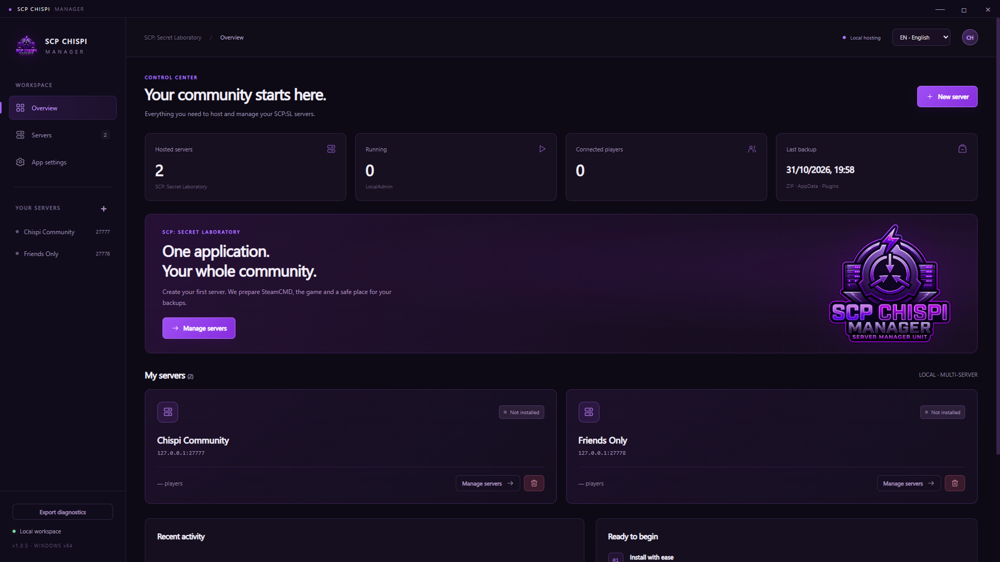
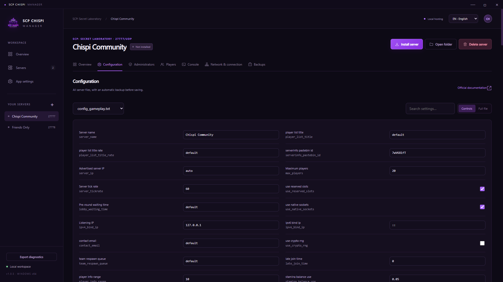
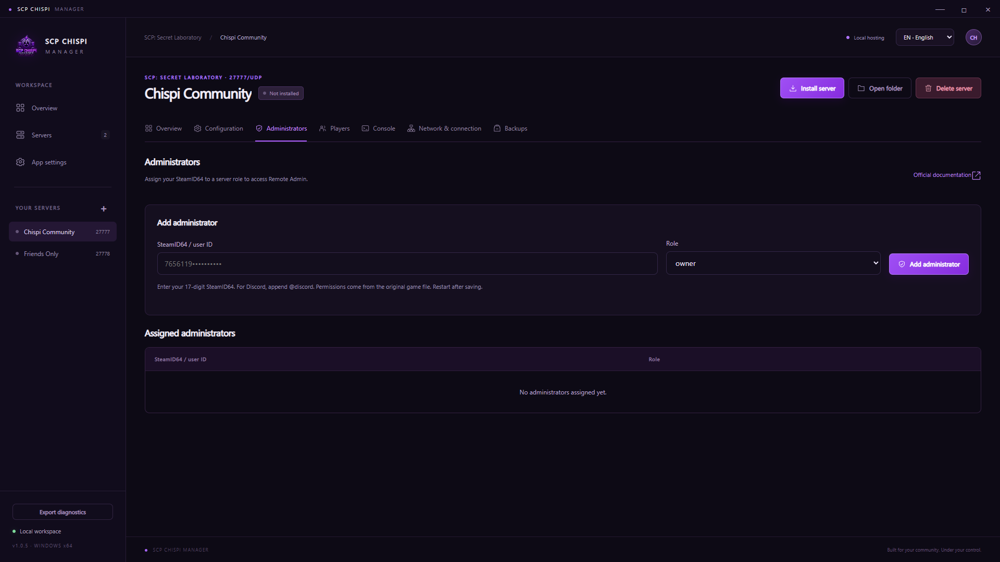
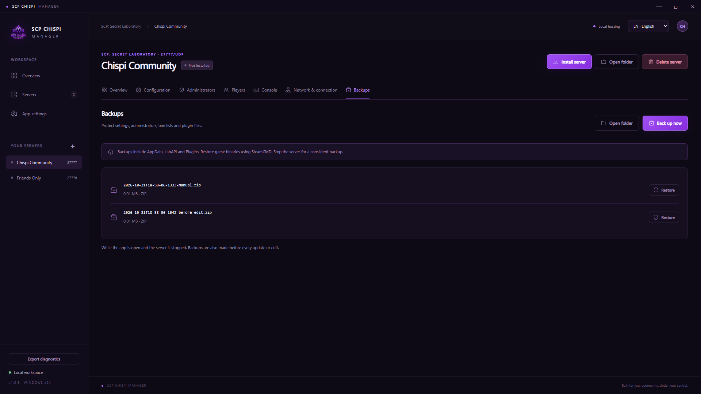
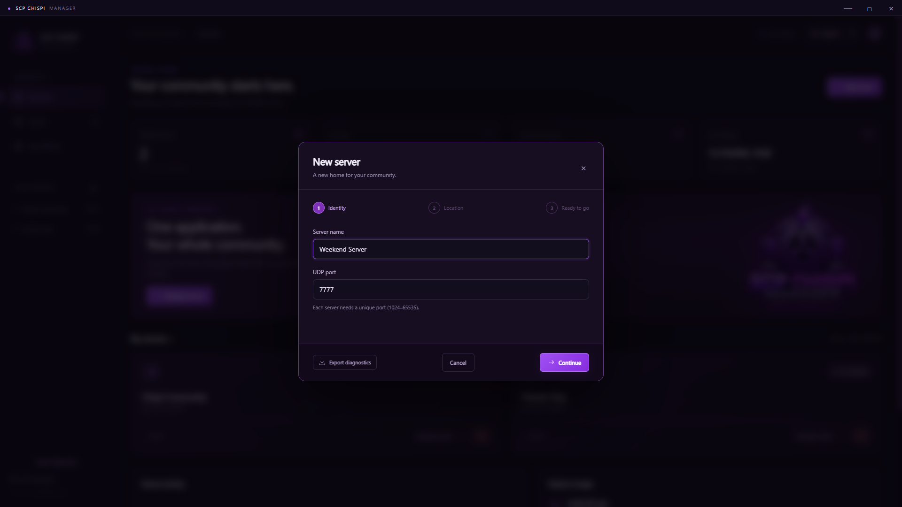

# Application screenshots

These are real, unretouched captures of SCP Chispi Manager 1.0.5 in English at **1920 × 1080**. They use two isolated example profiles, loopback addresses, and configuration templates from a locally installed game. No game processes were started for the gallery. No real player lists, VAC results, user identifiers, private addresses, API keys, or personal diagnostics are shown.

The profiles are intentionally displayed as not installed: the gallery creates their configuration and backups without downloading the game. Configuration templates are read from a local installation when available and are not redistributed as template files in this repository.

## Dashboard



## Configuration



## Administration



## Backups



## New server wizard



## Recreate the gallery

Install development dependencies and run:

```powershell
node scripts/capture-screenshots.cjs
```

To capture a previously built executable instead:

```powershell
node scripts/capture-screenshots.cjs --packaged
```

The script creates disposable profiles under ignored `output/`, selects English and loopback networking, captures real application views, and checks that no Windows user-profile path or private network address is visible. It does not modify existing server profiles. Optional vanilla templates come from `runtime/library/servers/*/game/ConfigTemplates`; without them, the available initial controls and roles may differ.

Review every new image before publishing it. PNG files belong in `docs/screenshots/` and are embedded directly in the project README.
